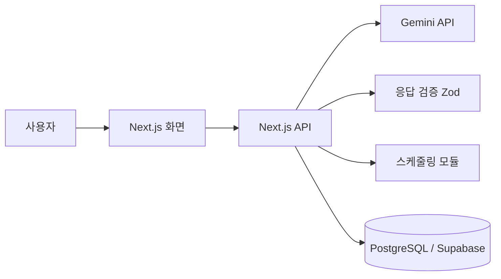

# 틈 플래너 (Teum Planner)

자유롭게 입력한 일정 메모를 AI가 항목별로 정리하고, 스케줄링 알고리즘이 고정 일정 사이의 빈 시간에 자동으로 배치하는 일정 관리 웹 서비스

| 구분 | 내용 |
| --- | --- |
| 과목 | OSS 기반 SW 프로그래밍 |
| 형태 | 개인 프로젝트 |
| 기간 | 16주 (1학기) |
| 라이선스 | MIT License |
| 진행 상태 | 기획 단계 |

## 목차

1. [프로젝트 개요](#1-프로젝트-개요)
2. [문제 정의](#2-문제-정의)
3. [개발 범위](#3-개발-범위)
4. [핵심 기능](#4-핵심-기능)
5. [시스템 설계](#5-시스템-설계)
6. [기술 스택](#6-기술-스택)
7. [마일스톤](#7-마일스톤)
8. [평가 계획](#8-평가-계획)
9. [리스크 및 대응](#9-리스크-및-대응)
10. [오픈소스 운영 방식](#10-오픈소스-운영-방식)

---

## 1. 프로젝트 개요

틈 플래너는 할 일과 약속을 정해진 양식 없이 문장으로 입력하면, AI가 이를 제목, 종류, 마감, 예상 소요시간, 우선순위로 구조화하고, 직접 설계한 스케줄링 알고리즘이 사용자의 고정 일정 사이의 빈 시간에 자동으로 배치하는 웹 서비스이다.

프로젝트명의 "틈"은 고정 일정 사이에 남는 빈 시간을 찾아 할 일을 채워 넣는다는 핵심 동작을 의미한다.

## 2. 문제 정의

### 2.1 배경

일정 관리 앱은 많지만, 사용하려면 제목, 날짜, 시간을 항목마다 직접 입력해야 하는 수고가 따른다. 바쁠수록 이 과정을 건너뛰게 되고, 할 일은 메모장과 메신저에 흩어진 채 마감 직전에야 다시 떠올라 시간에 쫓기게 된다. 또한 할 일을 정리하더라도 언제 수행할지를 정하는 판단은 여전히 사용자에게 남는다.

### 2.2 문제

| 단계 | 현재의 문제 | 본 프로젝트의 접근 |
| --- | --- | --- |
| 기록 | 항목별 직접 입력이 번거로워 기록이 지속되지 않음 | 자유 문장 입력을 AI가 구조화 |
| 배치 | 정리된 할 일을 언제 수행할지 매번 사용자가 판단해야 함 | 알고리즘이 빈 시간에 자동 배치 |

### 2.3 대상 사용자

- 과제, 시험, 아르바이트 등 여러 일정에 약속이 뒤섞인 대학생
- 일정이 자주 바뀌는 1인 작업자(프리랜서)

### 2.4 기존 서비스와의 비교

| 구분 | 기존 AI 일정 서비스 (Motion, Reclaim 등) | 틈 플래너 |
| --- | --- | --- |
| 언어 | 영어 중심 | 한국어 자유 입력 |
| 비용 | 주요 기능이 유료 플랜 중심 | 무료, 오픈소스 |
| 입력 방식 | 정해진 양식 위주 | 문장 형태의 메모를 그대로 입력 |
| 배치 근거 | 배치 이유에 대한 설명이 부족 | 배치 결과마다 이유를 함께 제공 (예: "마감이 가장 임박하여 오늘 저녁에 배치") |

## 3. 개발 범위

16주 안에 완성도 있는 결과물을 내기 위해, 핵심 흐름(입력 → 정리 → 배치 → 확인)을 우선 구현하고 나머지는 향후 과제로 분리한다.

| 포함 (본 학기 구현) | 제외 (향후 과제) |
| --- | --- |
| 회원가입 및 로그인 | Google 캘린더 등 외부 캘린더 연동 |
| 자연어 입력의 AI 정리 및 확인·수정 | 푸시 알림, 이메일 알림 |
| 고정 일정(수업, 약속) 등록 | 반복 규칙이 복잡한 일정 (격주, 매월 n번째 요일 등) |
| 빈 시간 계산 및 자동 배치 | 모바일 앱 |
| 주간·월간 캘린더, 드래그 이동 후 재배치 | 다중 사용자 일정 공유 |
| 배치 이유 표시 | |

## 4. 핵심 기능

### 4.1 자연어 입력 및 AI 정리

"내일 3시에 치과, 주말에 장보기"와 같이 자유롭게 입력하면, AI가 항목마다 제목, 종류(할 일/약속), 마감, 예상 소요시간, 우선순위를 추출하여 정해진 JSON 형식으로 반환한다. 사용자는 저장 전에 결과를 확인하고 직접 수정할 수 있다.

입력 예시

```text
금요일까지 운영체제 과제, 내일 3시에 치과, 주말에 장보기
```

출력 예시 (기준일 2026-10-15)

```json
[
  { "title": "운영체제 과제", "type": "task",  "deadline": "2026-10-16T23:59", "durationMin": 180, "priority": "high" },
  { "title": "치과",          "type": "event", "start": "2026-10-16T15:00",    "durationMin": 60 },
  { "title": "장보기",        "type": "task",  "deadline": "2026-10-18T23:59", "durationMin": 60,  "priority": "low" }
]
```

### 4.2 자동 스케줄링

고정 일정을 피해 빈 시간대에, 마감 임박도와 우선순위가 높은 할 일부터 배치하는 알고리즘을 직접 구현한다. 긴 작업은 여러 블록으로 나누어 배치하고, 일정이 변경되면 다시 배치한다. 상세 절차는 [5.4 스케줄링 알고리즘](#54-스케줄링-알고리즘)에 기술한다.

### 4.3 캘린더 및 배치 이유 표시

주간·월간 캘린더에 배치 결과를 보여 주고, 각 블록에 해당 시간에 배치된 이유를 한 줄로 표시한다. 사용자가 블록을 드래그하여 옮기면 해당 블록은 고정되고, 나머지 일정이 다시 조정된다.

### 4.4 설계 원칙: AI와 알고리즘의 역할 분리

| 담당 | 역할 | 근거 |
| --- | --- | --- |
| AI | 문장 해석 및 항목 구조화 | 자연어 해석은 규칙 기반으로 처리하기 어려움 |
| 알고리즘 | 빈 시간 계산, 배치, 배치 이유 생성 | 동일 입력에 동일 결과를 보장하고, 일정 중복을 방지하며, 단위 테스트로 검증 가능 |

배치 이유 문구 역시 AI가 아닌 알고리즘이 배치 근거(마감, 우선순위, 가용 시간)를 바탕으로 생성하므로, 실제 배치 로직과 설명이 항상 일치한다.

## 5. 시스템 설계

### 5.1 전체 구조



### 5.2 처리 흐름

1. 사용자가 일정 메모를 문장으로 입력한다.
2. 서버는 입력 문장과 기준 날짜·시간대를 함께 AI에 전달하고, JSON 스키마에 맞춘 응답을 받는다.
3. 응답을 스키마로 검증하고, 형식이 맞지 않으면 1회 재요청한다.
4. 사용자가 확인 화면에서 결과를 검토·수정한 뒤 저장한다.
5. 스케줄링 모듈이 빈 시간을 계산하여 할 일을 배치하고, 배치 이유와 함께 저장한다.
6. 캘린더 화면에 결과를 표시한다.

### 5.3 데이터 모델 (초안)

| 테이블 | 주요 컬럼 | 설명 |
| --- | --- | --- |
| `profiles` | id, timezone, active_start, active_end | 사용자 설정 (활동 시간대 등) |
| `fixed_events` | id, user_id, title, start_at, end_at, weekly_repeat | 수업, 약속 등 고정 일정 |
| `tasks` | id, user_id, title, deadline, duration_min, priority, status | AI가 정리한 할 일 |
| `scheduled_blocks` | id, task_id, start_at, end_at, reason, is_locked | 배치 결과, 배치 이유, 사용자 고정 여부 |

모든 테이블은 행 단위 보안(Row Level Security)을 적용하여 사용자 본인의 데이터만 조회·수정할 수 있도록 한다.

### 5.4 스케줄링 알고리즘

1단계로 그리디(greedy) 방식을 구현하고, 테스트로 검증한 뒤 분할·재배치 기능을 추가한다.

1. **가용 시간 계산**: 배치 기간(기본 7일)의 활동 시간대에서 고정 일정과 사용자가 고정한 블록을 제외하여 빈 구간 목록을 만든다.
2. **우선순위 점수 계산**: 할 일마다 `점수 = 우선순위 가중치 + 마감 임박도`를 계산한다. 마감 임박도는 남은 가용 시간 대비 필요 시간의 비율로 산출한다.
3. **배치**: 점수가 높은 할 일부터, 마감 이전의 가장 이른 빈 구간에 배치한다.
4. **분할**: 소요시간이 최대 블록 길이(기본 2시간)를 넘으면 여러 블록으로 나누어 배치한다.
5. **예외 처리**: 마감 전까지 가용 시간이 부족하면 배치하지 않고 "시간 부족" 경고를 표시한다.
6. **이유 생성**: 배치에 사용된 근거를 정해진 문장 틀에 채워 배치 이유를 만든다.

## 6. 기술 스택

프론트엔드와 백엔드를 TypeScript로 통일한 Next.js 풀스택 구조를 채택하며, 사용하는 라이브러리는 모두 오픈소스이다.

| 영역 | 선택 | 선정 이유 |
| --- | --- | --- |
| 프레임워크 | Next.js + TypeScript | 기존 JavaScript 경험 활용, 화면과 API를 하나의 프로젝트로 관리하여 1인 개발에 적합 |
| DB 및 인증 | PostgreSQL (Supabase) | 오픈소스 PostgreSQL 기반, 인증 기능 내장, 행 단위 보안으로 사용자별 데이터 분리 |
| AI | Gemini API 무료 티어 (Flash 계열) | 별도 비용 없이 사용 가능, JSON 스키마를 지정하는 구조화 출력 지원 |
| 응답 검증 | Zod | AI 응답을 스키마로 검증하여 잘못된 값의 저장을 방지 |
| 캘린더 UI | FullCalendar (MIT) | 주간·월간 보기와 드래그 이동 기능 제공 |
| 테스트 및 CI | Vitest + GitHub Actions | 스케줄링 알고리즘의 단위 테스트, 푸시마다 자동 실행 |
| 배포 | Vercel (무료 플랜) | Next.js 배포 지원, 저장소 푸시 시 자동 배포 |

## 7. 마일스톤

### 7.1 단계별 일정

| 단계 | 1 | 2 | 3 | 4 | 5 | 6 | 7 | 8 | 9 | 10 | 11 | 12 | 13 | 14 | 15 | 16 |
| --- | :-: | :-: | :-: | :-: | :-: | :-: | :-: | :-: | :-: | :-: | :-: | :-: | :-: | :-: | :-: | :-: |
| 기획 및 환경 구축 | ■ | ■ | | | | | | | | | | | | | | |
| 기반 개발 | | | ■ | ■ | ■ | | | | | | | | | | | |
| AI 정리 기능 | | | | | | ■ | ■ | ■ | | | | | | | | |
| 자동 스케줄링 | | | | | | | | | ■ | ■ | ■ | ■ | | | | |
| 완성도 개선 및 최적화 | | | | | | | | | | | | | ■ | ■ | | |
| 배포 및 발표 | | | | | | | | | | | | | | | ■ | ■ |
| 점검 | | | | | | | | ◆ | | | | | | | | ◆ |

◆ 8주차: 중간 점검 / 16주차: 최종 발표

### 7.2 주차별 상세 계획

| 주차 | 단계 | 목표 | 산출물 |
| :-: | --- | --- | --- |
| 1 | 기획 및 환경 구축 | 요구사항 정리, 유사 서비스 조사 | 요구사항 명세, 제안서 |
| 2 | 기획 및 환경 구축 | 저장소 및 CI 구성, 화면 와이어프레임 작성 | GitHub 저장소, 와이어프레임 |
| 3 | 기반 개발 | Next.js와 Supabase 연동, 회원가입 및 로그인 | 인증 기능 |
| 4 | 기반 개발 | 데이터 모델 설계 및 마이그레이션 | ERD, 마이그레이션 스크립트 |
| 5 | 기반 개발 | 할 일 및 고정 일정의 등록·수정·삭제 | CRUD 화면 |
| 6 | AI 정리 기능 | Gemini API 연동, 프롬프트 및 JSON 스키마 설계 | 문장 → JSON 변환 기능 |
| 7 | AI 정리 기능 | 응답 검증, 상대 날짜 해석, 확인·수정 화면 | 정리 결과 확인 후 저장 기능 |
| 8 | AI 정리 기능 | 테스트 문장 세트로 정리 정확도 측정 | 중간 점검 |
| 9 | 자동 스케줄링 | 가용 시간 계산 | 가용 시간 계산 모듈 및 단위 테스트 |
| 10 | 자동 스케줄링 | 우선순위·마감 기반 배치 알고리즘 구현 | 자동 배치 기능 |
| 11 | 자동 스케줄링 | FullCalendar 연동, 주간·월간 보기 | 캘린더 화면 |
| 12 | 자동 스케줄링 | 작업 분할, 드래그 이동 후 재배치 | 재배치 기능 및 단위 테스트 |
| 13 | 완성도 개선 및 최적화 | 배치 이유 생성, API 호출 한도 대응 | 배치 이유 표시, 오류 처리 |
| 14 | 완성도 개선 및 최적화 | 쿼리 및 인덱스 최적화, UI 개선, 테스트 보강 | 성능 개선 기록 |
| 15 | 배포 및 발표 | 서비스 배포, 사용자 테스트 (3~5명) | 배포 URL, 사용자 피드백 정리 |
| 16 | 배포 및 발표 | 문서 정리, 최종 발표 | 최종 보고서, 발표 자료 |

## 8. 평가 계획

| 평가 항목 | 방법 | 목표 |
| --- | --- | --- |
| AI 정리 정확도 | 직접 작성한 테스트 문장 30개를 입력하여, 수정 없이 저장 가능한 비율 측정 | 80% 이상 |
| 배치 정확성 | 일정 중복, 마감 초과 여부를 단위 테스트로 검증 | 테스트 전체 통과, 중복 0건 |
| 응답 시간 | 입력부터 정리 결과 표시까지의 시간 측정 | 평균 5초 이내 |
| 사용성 | 사용자 3~5명이 일주일치 일정을 입력해 보고 설문 | 기존 방식 대비 입력이 편리하다는 응답 과반 |

## 9. 리스크 및 대응

| 리스크 | 대응 |
| --- | --- |
| 무료 API 호출 한도 초과 | 여러 항목을 한 번의 요청으로 처리, 동일 입력 결과 캐시, 초과 시 재시도 및 안내 |
| AI의 날짜·시간 해석 오류 | 기준 날짜·시간대를 함께 전달, 저장 전 확인·수정 화면 제공 |
| 무료 티어 입력 데이터의 모델 학습 활용 가능성 | 민감 정보 입력 자제 안내, AI 호출부를 분리하여 로컬 오픈소스 LLM으로 교체 가능하도록 설계 |
| 알고리즘 복잡도 증가로 인한 일정 지연 | 그리디 방식으로 우선 구현, 분할·재배치는 단계적으로 추가 |
| 1인 개발로 인한 일정 관리 어려움 | 주차별 목표를 GitHub 이슈와 마일스톤으로 관리, 제외 범위 기능은 핵심 기능 완성 후에만 착수 |

## 10. 오픈소스 운영 방식

- **라이선스**: MIT License
- **작업 관리**: 주차별 목표를 GitHub Issues와 Milestones로 등록하여 진행 상황을 공개한다.
- **브랜치 전략**: `main`(배포) / `dev`(개발) / `feature/*`(기능 단위)로 운영하고, 기능 단위로 Pull Request를 작성한다.
- **커밋 규칙**: `feat`, `fix`, `docs`, `test`, `refactor` 등 접두어를 사용한다.
- **문서**: 설치 및 실행 방법, 기여 방법(CONTRIBUTING.md)은 구현 진행에 맞추어 추가한다.

---

본 제안서의 전반적인 프로젝트 규모 산정과 마일스톤 초안 작성에는 AI의 도움을 받았습니다.
